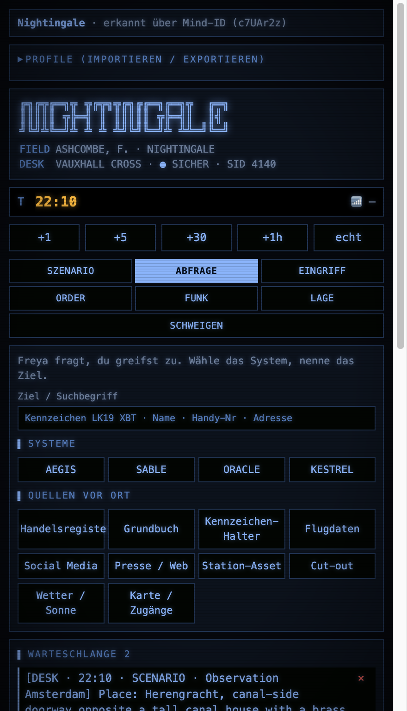
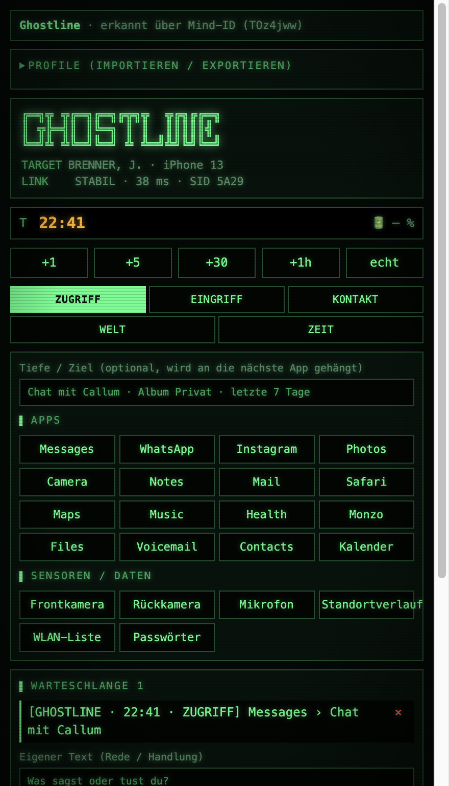
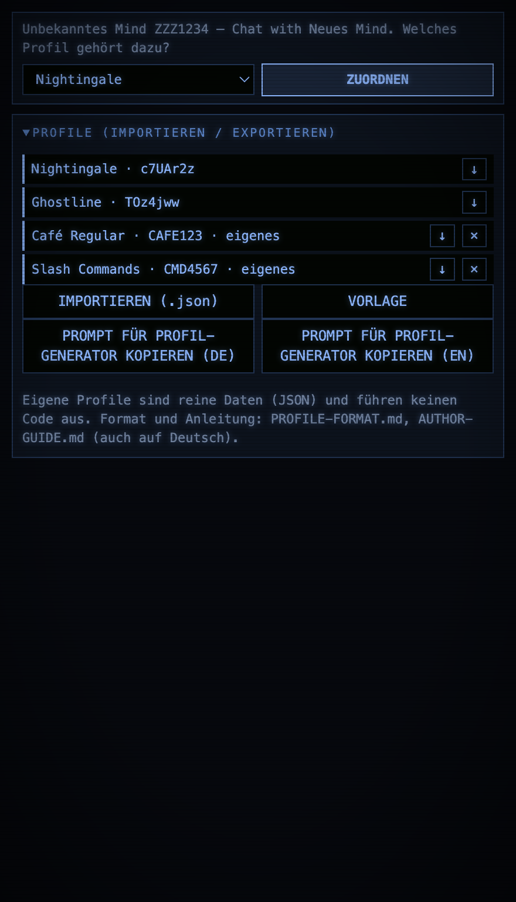
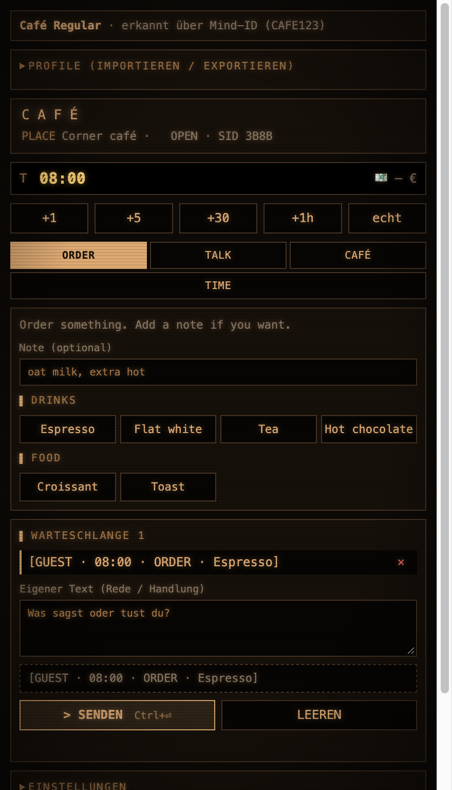
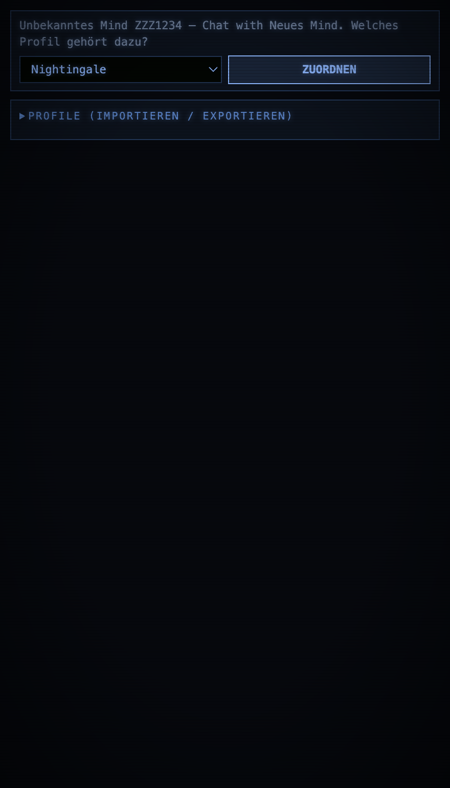
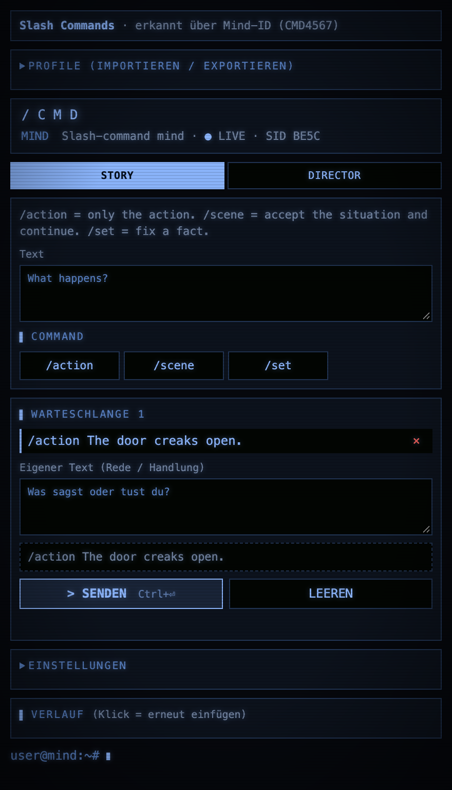

# Mind Console

**Deutsch** · [English](README.md)

Eine Chrome-Erweiterung, die neben einem Venice-Mind-Chat ein **Bedienpanel** einblendet. Ein Klick auf einen Button
fügt eine fertig formatierte Zeile in die Chatbox ein, zum Beispiel `[NIGHTINGALE · 21:40 · QUERY · AEGIS] Karl Weiss`.
Das Mind liest diese Zeilen als Spielzüge, das Panel liest die Statuszeile der Antwort zurück und zeigt sie als HUD.

Die Erweiterung erkennt das Mind im aktiven Tab selbst und lädt dessen **Profil**. Profile sind reine Daten (JSON), eigene
Profile lassen sich im Panel hochladen. Eingebaut sind zwei Profile: *Nightingale* (Agentin und Operator) und *Ghostline* (Hacker).

> Stand: v1.0.0. Getestet mit einem Headless-Electron und nachgebautem `chrome`-Objekt, nicht in einem echten Chrome gegen die
> echte Venice-Seite. Siehe [Tests und Grenzen](#tests-und-grenzen).

## Inhalt
- [Funktionen](#funktionen)
- [Sprachen](#sprachen)
- [Installation](#installation)
- [Bedienung](#bedienung)
- [Mind-Erkennung](#mind-erkennung)
- [Eingebaute Profile](#eingebaute-profile)
- [Eigene Profile](#eigene-profile)
- [Dokumentation](#dokumentation)
- [Chat-Darstellung](#chat-darstellung)
- [Aufbau und Datenfluss](#aufbau-und-datenfluss)
- [Sicherheit und Datenschutz](#sicherheit-und-datenschutz)
- [Tests und Grenzen](#tests-und-grenzen)
- [Fehlerbehebung](#fehlerbehebung)
- [Projektstruktur](#projektstruktur)
- [Entwicklung](#entwicklung)

## Funktionen
- **Ein Panel für mehrere Minds.** Das Profil wechselt mit dem Tab. Zeit, Warteschlange, Verlauf und Einstellungen sind pro Mind getrennt.
- **Buttons statt Tippen.** Aktionen, Ereignisse und Zeitsprünge als Klick. Die Zeilen sind einheitlich formatiert, damit das Mind sie zuverlässig liest.
- **Warteschlange.** Mehrere Aktionen sammeln, eigenen Text dazuschreiben, dann gemeinsam senden (Strg/Cmd + Enter).
- **HUD.** Liest die Statuszeile `⏱ HH:MM · 📍 Ort · …` aus der letzten Antwort und zeigt Ort, Werte und Anzeigen. Die Spielzeit wird übernommen.
- **Chat-Optik.** Terminal-Theme, Scanlines, Event-Zeilen als farbige Balken und Display-Rahmen für ASCII-Blöcke, jeweils in den Farben des Profils.
- **Szenarien.** Vorgefertigte Einsätze mit festem Ort, Datum, Wetter und Auftrag, wahlweise mit geheimer Komplikation (Nightingale).
- **Tastenkürzel.** `Alt+1…9` drückt den nummerierten Button des offenen Reiters, `Alt+←/→` wechselt den Reiter, `Alt+Z` entfernt die letzte Zeile, `Alt+X` leert die Queue, `Alt+F` durchsucht den Verlauf, `Alt+T` fokussiert die Uhr.
- **Favoriten.** Die Queue als einen Button speichern; er reiht die Zeilen mit der aktuellen Spielzeit wieder ein.
- **Verlauf mit Suche und Pins.** Einträge anpinnen, filtern oder zum Favoriten machen.
- **Sitzungs-Export.** Markdown oder JSON mit Verlauf, Queue, Uhr, HUD-Stand und Favoriten.
- **Spielstände.** Mehrere benannte Stände von Uhr, Queue und Verlauf pro Mind.
- **Bedingte Buttons.** Profile können Reiter, Blöcke und Buttons abhängig von den HUD-Werten ein- und ausblenden (`when`).
- **Profil-Editor.** Profile im Panel bearbeiten, kopieren und neu anlegen, mit Live-Prüfung und einer Vorschau, die nichts speichert.
- **Regeln im Panel.** Würfel und Zufallstabellen, geplante Weltereignisse an die Spielzeit gebunden, Spielzustand (HP, Geld, Rucksack) mit Zustandszeile und Buttons aus Listen. Profile schalten sie ein, siehe [PROFILE-FORMAT.de.md](PROFILE-FORMAT.de.md#regeln-im-panel-v12).
- **Relay zwischen zwei Minds.** Die letzte Antwort eines Minds in die Chatbox eines anderen kopieren (Spielleiter und Figur). Das manuelle Relay fügt nur ein; Senden ist ein eigener Schalter.
- **Vollbild-Konsole (Prototyp).** Der Button **VOLLBILD** öffnet die Konsole in einem eigenen Tab. Dort wählst du, welcher offene Venice-Tab das Mind ist, und kannst in anderen Tabs arbeiten, während es im Hintergrund läuft. Der ganze Chat steht neben der Konsole (aus dem Venice-Tab gelesen, nur Text). Chrome kann verdeckte Tabs bremsen.
- **Auto-Forward.** Optional: neue, fertige Antworten werden selbstständig weitergegeben und gesendet, in eine Richtung oder hin und her, mit Höchstzahl, Wartezeit, roter STOPP-Leiste und mehreren automatischen Stopps.
- **Mehrsprachige Oberfläche.** Standard ist Englisch, Deutsch ist enthalten. Umschalten mit der Sprachauswahl oben im Panel; Profile können eigene Übersetzungen mitbringen.
- **Eigene Profile hochladen.** Import, Export, Löschen, Vorlage und ein Prompt, mit dem ein Chat-Modell ein Profil aus einer Mind-Beschreibung schreibt.

## Sprachen
Das Panel ist **standardmäßig Englisch**. Die Sprachauswahl oben schaltet zwischen Englisch und Deutsch um; die Wahl wird gespeichert und gilt für alle Minds. Die Beschriftungen in dieser Dokumentation (*ZUORDNEN*, *WARTESCHLANGE* …) entsprechen der deutschen Oberfläche.

Die eingebauten Profile sind mit übersetzt (Reiter, Beschriftungen, Buttons und der Text, den die Buttons senden). **Nicht** übersetzt werden die Ereignis-Arten in den Zeilen (`QUERY`, `OPERATE`, `EINGRIFF`, …): sie sind das Protokoll zwischen Panel und Mind, damit bestehende Minds weiter funktionieren.
Profile können mehrere Sprachen in einer Datei enthalten, siehe [PROFILE-FORMAT.de.md](PROFILE-FORMAT.de.md#mehrsprachige-texte). Für eine weitere Oberflächensprache in `i18n.js` ein Objekt unter `STRINGS` und einen Eintrag in `LANGS` ergänzen; fehlende Schlüssel fallen auf Englisch zurück.

## Installation
1. Repository herunterladen oder klonen.
2. In Chrome `chrome://extensions` öffnen und oben rechts den **Entwicklermodus** einschalten.
3. **Entpackte Erweiterung laden** und diesen Ordner wählen.
4. Einen Mind-Chat auf `venice.ai` öffnen und das Erweiterungs-Symbol anklicken, dann öffnet sich das Panel.

Andere Erweiterungen, die dieselbe Seite umbauen (zum Beispiel die älteren Einzel-Erweiterungen *Ghostline Phone* oder *Nightingale Desk*), vorher ausschalten.
Sie bearbeiten dieselben Absätze und führen zu leeren Sprechblasen.

## Bedienung
Das Panel besteht von oben nach unten aus:

| Bereich | Zweck |
|---|---|
| **Mind-Leiste** | Zeigt das erkannte Mind und woran es erkannt wurde. Bei einem unbekannten Mind erscheint eine Profil-Auswahl mit *Zuordnen*. |
| **PROFILE** | Importieren, Exportieren, Bearbeiten, Kopieren, Löschen, neues Profil im Editor, Vorlage, Generator-Prompt (siehe [Eigene Profile](#eigene-profile)). |
| **Kopf, Uhr, Zeitknöpfe** | Logo, Spielzeit (editierbar), `+1 / +5 / +30 / +1h` und `echt` für die Systemzeit. Profile ohne Spielzeit blenden das aus. |
| **HUD** | Zustand aus der letzten Antwort des Minds. |
| **Reiter** | Die Befehle des Profils. Jeder Klick stellt eine Zeile in die Warteschlange. |
| **Warteschlange** | Zeilen prüfen, einzeln entfernen, eigenen Text ergänzen, Vorschau, *Senden* oder *Leeren*. |
| **Einstellungen** | Sofort senden, anhängen oder ersetzen, automatisch absenden, Reihenfolge, Präfixe, Uhr-Vorrückung, Chat-Darstellung, Konventions-Text. |
| **Favoriten** | Erscheint über den Reitern, sobald einer gespeichert ist. Ein Klick reiht alle Zeilen ein. |
| **Relay** | Zwei Mind-Tabs als A und B wählen und die letzte Antwort des einen in den anderen kopieren. Nur eingefügt; Senden ist ein eigener Schalter. *AUTO-FORWARD* macht das selbstständig und sendet (siehe unten). |
| **Spielstände** | Benannte Stände von Uhr, Queue und Verlauf. Beim Laden wird der aktuelle Stand vorher gesichert. |
| **Verlauf** | Die letzten 100 gesendeten Texte plus angepinnte. Suchen, anpinnen, Klick fügt erneut ein, Export als `.md` oder `.json`. |

**Auto-Forward** (im Bereich *Relay*): Richtung wählen (A → B, B → A oder hin und her), die Höchstzahl der Weitergaben und wie lange eine Antwort unverändert bleiben muss, bis sie als fertig gilt. Nach *STARTEN* beobachtet das Panel beide Tabs und gibt jede **neue** Antwort weiter, ersetzt dabei den Inhalt der Chatbox und sendet. Antworten, die beim Start schon in den Chats stehen, werden nicht weitergegeben; um ein Gespräch anzustoßen, schickst du die erste Nachricht in einem Tab selbst. Es stoppt von selbst bei Erreichen der Höchstzahl, wenn ein Tab geschlossen wird, nach 3 Minuten ohne neue Antwort oder wenn du in der roten Leiste oben *STOPP* drückst. Das Panel muss offen bleiben: Schließt du es, endet die Automatik. Chrome kann Tabs im Hintergrund bremsen, Antworten kommen dann später.

**Konventions-Text einfügen** (Einstellungen) schreibt eine Erklärung der Zeilenformate in die Chatbox. Sinnvoll, wenn das Mind das Format noch nicht
im Prompt kennt. Besser ist es, die Erklärung in den Prompt des Minds zu übernehmen.

## Mind-Erkennung
Reihenfolge, in der das Profil bestimmt wird:
1. **Manuelle Zuordnung** (Mind-ID → Profil), im Panel gesetzt und entfernbar.
2. **Mind-ID** aus der URL: `venice.ai/chat/minds/local/<MIND-ID>/<chat>` oder `venice.ai/minds/local/<MIND-ID>/edit`.
3. **Seitentitel** (`titleMatch` des Profils, z. B. „Chat with Lana“).

Die Mind-ID bleibt auch beim Umbenennen des Minds gleich. Kein passendes Profil heißt: Das Panel zeigt die Zuordnung, die Seite bleibt unverändert.

## Eingebaute Profile
| Profil | Mind-ID | Rolle | Reiter |
|---|---|---|---|
| **Nightingale** | `c7UAr2z` | Du bist der Operator im Ohr einer SIS-Feldoffizierin. | Szenario, Abfrage, Eingriff, Order, Funk, Lage, Schweigen |
| **Ghostline** | `TOz4jww` | Du bist ein Hacker auf dem Handy einer Zielperson. | Zugriff, Eingriff, Kontakt, Welt, Zeit |

Nightingale-Statuszeile: `⏱ HH:MM · 📍 Ort · 📶 Signal · 🩹 Zustand · Cover n/4`.
Ghostline-Statuszeile: `⏱ HH:MM · 📍 Ort · 📱 App · 34 % · Verdacht 2/4`.

## Eigene Profile
Im Panel unter **PROFILE (IMPORTIEREN / EXPORTIEREN)**:

- **IMPORTIEREN (.json):** ein Profil, eine Liste oder `{ "profiles": [...] }`. Das Profil wird geprüft, Fehler werden einzeln gemeldet. Eine gleiche id ersetzt dein eigenes Profil, eingebaute ids sind geschützt.
- **VORLAGE:** lädt ein lauffähiges Beispiel.
- **⭳ und ×:** Profil exportieren oder löschen. Exportierte eingebaute Profile sind gute Beispiele.
- **PROMPT FÜR PROFIL-GENERATOR KOPIEREN (DE / EN):** kopiert den Prompt (deutsche oder englische Fassung) aus [PROMPT-Profile-Generator.de.md](PROMPT-Profile-Generator.de.md).
  In einen normalen Chat einfügen, unten „MEIN MIND“ ausfüllen und die Antwort als `.json` speichern.

Ein Profil kann Reiter mit Buttons, Eingabefeldern und Formularen, eine Statuszeile, Farben, Szenarien und sogar Slash-Befehle (`format: "raw"`) beschreiben.
Eine Schritt-für-Schritt-Anleitung steht im [Autoren-Leitfaden](AUTHOR-GUIDE.de.md), das vollständige Format in [PROFILE-FORMAT.de.md](PROFILE-FORMAT.de.md). Beispiele liegen in [`examples/`](examples/) mit einer [Übersicht](examples/README.de.md) (minimal, Café, Gastgeber, Noir, Netrunner, Survival, Slash-Befehle, zwei Minds).

**Wichtig:** Profile sind **Daten, kein Code**. Sie enthalten keine Funktionen und führen nichts aus.

## Dokumentation
Alle Dokumente gibt es auf Deutsch und Englisch:

| Thema | Deutsch | English |
|---|---|---|
| Überblick | [README.de.md](README.de.md) | [README.md](README.md) |
| Autoren-Leitfaden (eigenes Profil bauen) | [AUTHOR-GUIDE.de.md](AUTHOR-GUIDE.de.md) | [AUTHOR-GUIDE.md](AUTHOR-GUIDE.md) |
| Profil-Format (Referenz) | [PROFILE-FORMAT.de.md](PROFILE-FORMAT.de.md) | [PROFILE-FORMAT.md](PROFILE-FORMAT.md) |
| Generator-Prompt | [PROMPT-Profile-Generator.de.md](PROMPT-Profile-Generator.de.md) | [PROMPT-Profile-Generator.md](PROMPT-Profile-Generator.md) |

## Chat-Darstellung
Das Content-Script stylt den Chat des erkannten Minds (abschaltbar unter *Einstellungen → Chat-Darstellung*):
- **Terminal-Theme** und **Scanlines** in den Farben des Profils.
- **Event-Zeilen.** Zeilen wie `[PRÄFIX · HH:MM · ART · …] Text` in deinen Nachrichten werden zu farbigen Balken. Die Farbe bestimmt `eventKinds` im Profil. Erkannt werden nur Präfixe in Großbuchstaben.
- **Screens.** Codeblöcke, die mit `┌` oder `╔` beginnen oder `│` enthalten, bekommen einen Display-Rahmen.
- **HUD-Zeile.** Die `⏱`-Zeile der Antwort wird hervorgehoben und ans Panel gemeldet.

## Aufbau und Datenfluss
```
 Venice-Tab (venice.ai)                         Side Panel
 ┌──────────────────────────────┐   ┌──────────────────────────────────────────┐
 │ content.js                   │   │ sidepanel.html / .css / .js              │
 │  · erkennt das Mind (URL/Titel)│◄──┤  · erkennt das Mind aus Tab-URL/-Titel   │
 │  · füllt / sendet die Chatbox │   │  · baut Reiter aus dem Profil            │
 │  · stylt den Chat            │   │  · Warteschlange, Verlauf, Einstellungen │
 │  · liest die ⏱-Statuszeile   │──►│  · HUD aus dem Spielzustand              │
 └───────────────┬──────────────┘   └───────────────────┬──────────────────────┘
                 │      chrome.storage.local              │
                 └────────  <id>:gameState, <id>:theme  ──┘
                          mindMap, customProfiles, <id>:data
        beide laden:  profiles/registry.js (Erkennung, Prüfung, Vorlagen)  +  profiles/*.js (eingebaute Profile)
```
- **`profiles/registry.js`** hält eingebaute und eigene Profile, erkennt das Mind, prüft Profile (Farben, Namen, reguläre Ausdrücke, Aufbau) und füllt die Platzhalter (`{item}`, `{field.x}`, `{x|Ersatz}`).
- **`sidepanel.js`** rendert Reiter und Blöcke aus dem Profil und baut aus einer *Aktion* die Zeile für die Warteschlange.
- **`content.js`** schreibt in die Chatbox (mit nativem Setter und `input`-Event, damit React den Wert übernimmt), klickt den Senden-Button und beobachtet die Seite per `MutationObserver`.
- **`background.js`** öffnet das Panel beim Klick auf das Symbol.

**Speicher** (`chrome.storage.local`): pro Mind `<id>:data` (Zeit, Einstellungen, Warteschlange, Verlauf, eigene Szenarien), `<id>:theme`, `<id>:gameState`. Global `mindMap` und `customProfiles`.

## Sicherheit und Datenschutz
- **Keine Netzwerkzugriffe.** Die Erweiterung sendet nichts an Dritte, alles bleibt im Browser (`chrome.storage.local`).
- **Berechtigungen:** `sidePanel` (Panel), `storage` (Speicher), `scripting` (Content-Script nachladen) und Zugriff auf `venice.ai` (das erlaubt auch, URL und Titel des Venice-Tabs zu lesen und Nachrichten dorthin zu senden). Keine `tabs`-Berechtigung.
- **Kein fremder Code.** Importierte Profile sind JSON. Ihre Inhalte werden per `textContent` eingesetzt (`innerHTML` dient nur zum Leeren von Listen), es gibt kein `eval`. Farben, Namen und reguläre Ausdrücke werden vor dem Speichern geprüft.
- Die Erweiterung liest den Chat nur, um die `⏱`-Statuszeile und die Event-Zeilen auszuwerten.

## Tests und Grenzen
**Getestet** (automatisiert, in einem Headless-Electron mit nachgebautem `chrome`-Objekt und nachgebauten Venice-Seiten):
- Erkennung über Mind-ID, Titel und manuelle Zuordnung, Wechsel zwischen Minds mit getrennten Daten.
- Aktionen aus jedem Reiter der eingebauten Profile erzeugen die erwarteten Zeilen, inklusive Zeit-Vorrückung, Pflichtangaben und Szenarien. Nicht jeder einzelne Button wurde angeklickt.
- Import: kaputtes JSON, doppelte id, falsche Farben und ungültige reguläre Ausdrücke werden abgelehnt. Gültige Profile werden übernommen, ersetzt und gelöscht.
- Content-Script: Event-Balken, HUD, Screens, Statuszeile lesen, Einfügen und Absenden, unbekanntes Mind bleibt unberührt.

**Nicht getestet:**
- Die Erweiterung in einem echten Chrome gegen die echte Venice-Seite, die echte Dateiauswahl und der echte Download beim Export, das Kopieren in die Zwischenablage.
- Der Generator-Prompt wurde nicht mit einem Chat-Modell ausprobiert, nur sein Beispiel-JSON.
- Der **Venice-Seitenaufbau** kann sich ändern. Das Plugin hängt an diesen Selektoren: `textarea[aria-label="Chat message input"]`, `[data-testid="minds-chat-send-button"]`,
  `.assistant`, `.assistant-content`, `.codeblock`, `.minds-chat-container`, `.minds-chat-scroll`. Bricht etwas, sind sie die erste Anlaufstelle (`content.js`).

## Fehlerbehebung
| Problem | Ursache und Abhilfe |
|---|---|
| Sprechblasen sind leer | Eine zweite Erweiterung bearbeitet dieselben Absätze. Andere Venice-Erweiterungen ausschalten. |
| „Kein venice.ai-Tab gefunden“ | Einen Venice-Tab öffnen. Das Panel nimmt den aktiven oder zuletzt benutzten. |
| „Keine Chatbox gefunden“ | Der Mind-Chat ist nicht geöffnet oder Venice hat die Chatbox umgebaut (siehe Selektoren). |
| Panel zeigt „Unbekanntes Mind“ | Kein Profil passt. Profil zuordnen oder importieren. Die Mind-ID steht in der URL. |
| HUD bleibt leer | Das Mind beendet seine Antwort nicht mit der Statuszeile. Konventions-Text einfügen oder in den Prompt des Minds übernehmen. |
| Balken erscheinen nicht | Das Präfix in den Einstellungen ist nicht in Großbuchstaben, oder *Event-Zeilen formatieren* ist aus. |
| Import meldet Fehler | Die Meldung nennt das Feld. Ein Chat-Modell kann sie mit dem Generator-Prompt korrigieren. |

## Projektstruktur
```
manifest.json                 Chrome-Manifest (MV3)
background.js                 öffnet das Panel
content.js                    Läuft auf venice.ai: Eingabe, Styling, Statuszeile
sidepanel.html / .css / .js   Panel
i18n.js                       Oberflächentexte (Standard Englisch, Deutsch)
profiles/registry.js          Erkennung, Prüfung, Platzhalter
profiles/nightingale.js       eingebautes Profil
profiles/ghostline.js         eingebautes Profil
tests/                        Panel-Tests im Headless-Electron mit nachgebautem chrome-Objekt, siehe tests/README.md
examples/                     Beispielprofile zum Importieren, siehe examples/README.de.md (minimal, Café, Gastgeber, Noir, Netrunner, Survival, Slash-Befehle, zwei Minds)
AUTHOR-GUIDE(.de).md          Leitfaden: eigenes Profil bauen
PROFILE-FORMAT(.de).md        Format der Profile (Referenz)
PROMPT-Profile-Generator(.de).md  Prompt, der aus einer Mind-Beschreibung ein Profil erzeugt
README(.de).md                diese Dokumentation (Englisch / Deutsch)
Profile/                      eigene Profile (lokal, nicht versioniert)
```

## Entwicklung
- **Neues eingebautes Profil:** eine Datei in `profiles/` mit `MindProfiles.register({...})` anlegen (Daten wie im Format), in `manifest.json` unter `content_scripts.js`
  vor `content.js` und in `sidepanel.html` vor `sidepanel.js` eintragen, außerdem in `ensureContentScript` in `sidepanel.js`. Die Prüfung über `MindProfiles.validate(profile)` gilt für eingebaute und eigene Profile gleich.
- **Aktionen** werden deklarativ beschrieben (`parts`, `body`, `requires`, `shift`, `format`). Die Engine steht in `runAction` (`sidepanel.js`), die Platzhalter-Logik in `registry.js` (`fill`, `segments`, `parts`).
- **Neue Block-Typen** gehören in `renderBlock` (`sidepanel.js`) und in die Prüfung in `registry.js`.
- Nach Änderungen die Erweiterung auf `chrome://extensions` neu laden und den Venice-Tab neu laden.

## Screenshots

| | | | |
|---|---|---|---|
|  |  |  |  |
| Eingebaut: Nightingale | Eingebaut: Ghostline | Profil-Verwaltung | Eigenes Profil (Café) |

 

## Lizenz & Datenschutz
MIT – siehe [LICENSE](LICENSE). Keine Datenerhebung: [PRIVACY.de.md](PRIVACY.de.md). Texte und Berechtigungsbegründungen für den Chrome Web Store: [STORE-LISTING.md](STORE-LISTING.md). Upload-Paket bauen mit `./build.sh`.
