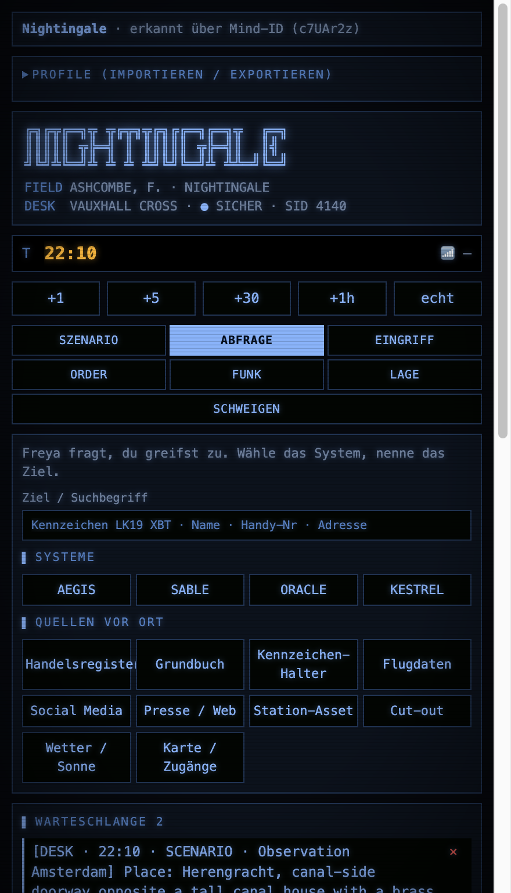
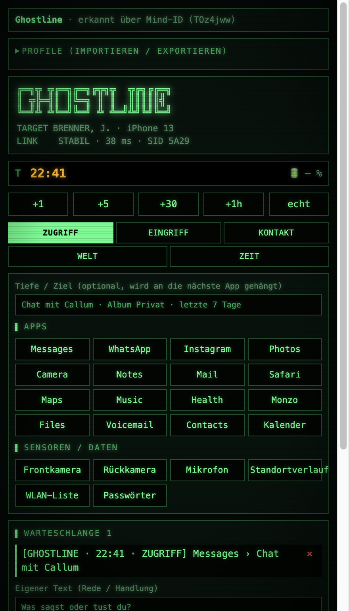
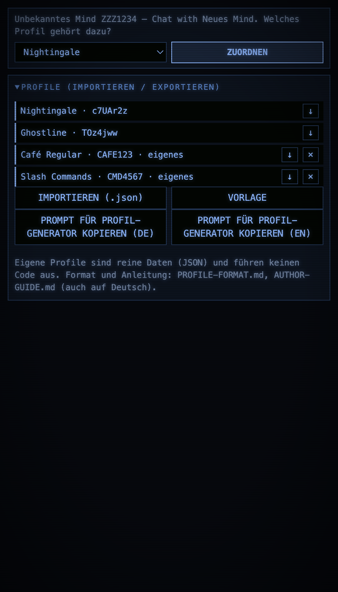
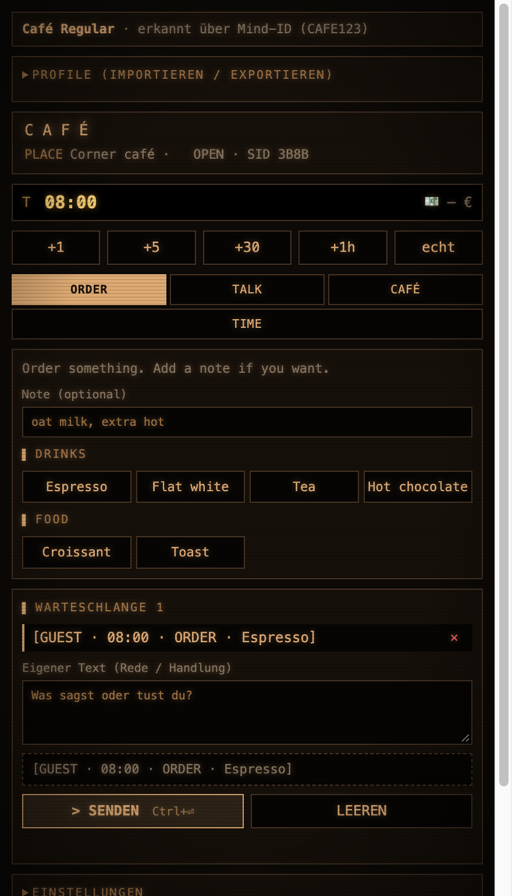
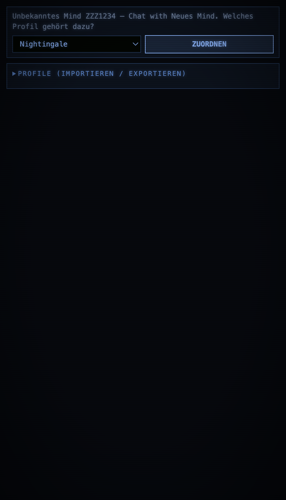
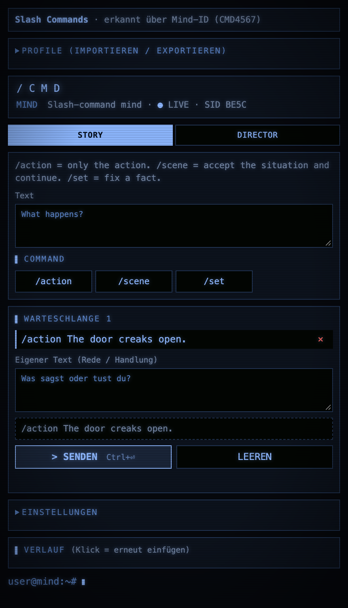

# Mind Console

[Deutsch](README.de.md) · **English**

A Chrome extension that shows a **control panel** next to a Venice mind chat. One click on a button inserts a ready-made line into the chatbox,
for example `[NIGHTINGALE · 21:40 · QUERY · AEGIS] Karl Weiss`. The mind reads these lines as moves, and the panel reads the
status line of the reply back and shows it as a HUD.

The extension recognises the mind in the active tab by itself and loads its **profile**. Profiles are plain data (JSON), and you can upload your own
in the panel. Two profiles are built in: *Nightingale* (agent and operator) and *Ghostline* (hacker).

> Status: v1.0.0. Tested with a headless Electron and a mocked `chrome` object, not in a real Chrome against the
> real Venice site. See [Tests and limits](#tests-and-limits).
>
> The panel is English by default and also available in German (see [Languages](#languages)). Profile texts (button names, hints) can be in any language.
> Some panel labels below are quoted from the German interface, with an English gloss.

## Contents
- [Features](#features)
- [Languages](#languages)
- [Installation](#installation)
- [Using the panel](#using-the-panel)
- [Mind detection](#mind-detection)
- [Built-in profiles](#built-in-profiles)
- [Your own profiles](#your-own-profiles)
- [Documentation](#documentation)
- [Chat appearance](#chat-appearance)
- [Architecture and data flow](#architecture-and-data-flow)
- [Security and privacy](#security-and-privacy)
- [Tests and limits](#tests-and-limits)
- [Troubleshooting](#troubleshooting)
- [Project structure](#project-structure)
- [Development](#development)

## Features
- **One panel for several minds.** The profile follows the tab. Time, queue, history and settings are kept separately per mind.
- **Buttons instead of typing.** Actions, events and time jumps with one click. The lines are formatted consistently, so the mind reads them reliably.
- **Queue.** Collect several actions, add your own text, then send them together (Ctrl/Cmd + Enter).
- **HUD.** Reads the status line `⏱ HH:MM · 📍 place · ...` from the last reply and shows place, values and meters. The in-world clock is taken over.
- **Chat appearance.** Terminal theme, scanlines, event lines as coloured bars and display frames for ASCII blocks, in the colours of the profile.
- **Scenarios.** Predefined missions with fixed place, date, weather and goal, optionally with a secret complication (Nightingale).
- **Keyboard shortcuts.** `Alt+1…9` press the numbered button of the open tab, `Alt+←/→` switch tabs, `Alt+Z` removes the last line, `Alt+X` clears the queue, `Alt+F` searches the history, `Alt+T` focuses the clock.
- **Favorites.** Save the queue as one button; it queues the lines again with the current in-world time.
- **History with search and pins.** Pin entries, filter them, turn one into a favorite.
- **Session export.** Markdown or JSON with history, queue, clock, HUD state and favorites.
- **Saves.** Several named saves of clock, queue and history per mind.
- **Conditional buttons.** Profiles can show tabs, blocks and buttons depending on the HUD values (`when`).
- **Profile editor.** Edit, copy and create profiles in the panel with live validation and a preview that saves nothing.
- **Relay between two Minds.** Copy the last reply of one Mind into the chat box of another (game master and character), manually, never sent automatically unless you switch that on.
- **Multilingual interface.** English by default, German included. Switch with the language selector at the top of the panel; profiles can bring their own translations.
- **Upload your own profiles.** Import, export, delete, template, and a prompt with which a chat model writes a profile from a description of your mind.

## Languages
The panel is **English by default**. The language selector at the top switches between English and German; the choice is stored and applies to all minds.

Built-in profiles are translated as well (tab names, labels, buttons and the text those buttons send). What is *not* translated are the event kinds in the lines (`QUERY`, `OPERATE`, `EINGRIFF`, …): they are the protocol between panel and mind, so existing minds keep working.
Profiles can contain several languages in one file, see [PROFILE-FORMAT.md](PROFILE-FORMAT.md#multilingual-texts). To add another interface language, add an object to `STRINGS` in `i18n.js` and an entry to `LANGS`; missing keys fall back to English.

## Installation
1. Download or clone the repository.
2. In Chrome open `chrome://extensions` and switch on **Developer mode** (top right).
3. **Load unpacked** and choose this folder.
4. Open a mind chat on `venice.ai` and click the extension icon. The panel opens.

Switch off other extensions that rework the same page first (for example the older single extensions *Ghostline Phone* or *Nightingale Desk*).
They edit the same paragraphs and lead to empty speech bubbles.

## Using the panel
From top to bottom the panel consists of:

| Area | Purpose |
|---|---|
| **Mind bar** | Shows the detected mind and how it was detected. For an unknown mind a profile selector with *ASSIGN* appears. |
| **PROFILES** | Import, export, edit, copy, delete, new profile in the editor, template, generator prompt (see [Your own profiles](#your-own-profiles)). |
| **Header, clock, time buttons** | Logo, in-world time (editable), `+1 / +5 / +30 / +1h` and `now` for the system time. Profiles without in-world time hide this. |
| **HUD** | State from the last reply of the mind. |
| **Tabs** | The commands of the profile. Each click puts one line into the queue. |
| **QUEUE** | Check lines, remove single ones, add your own text, preview, *SEND* or *CLEAR*. |
| **SETTINGS** | Send immediately, append or replace, auto-send, order, prefixes, clock advance, chat appearance, convention text. |
| **Favorites** | Appears above the tabs once you saved one. One click queues all its lines. |
| **RELAY** | Pick two Mind tabs as A and B and copy the last reply from one into the other. Inserted only; sending is a separate switch. |
| **SAVES** | Named saves of clock, queue and history. Loading backs up the current state first. |
| **HISTORY** | The last 100 sent texts plus pinned ones. Search, pin, click to insert again, export as `.md` or `.json`. |

**INSERT CONVENTION TEXT** (in the settings) writes an explanation of the line formats into the chatbox. Useful if the mind does not
know the format from its prompt yet. It is better to copy the explanation into the mind's prompt.

## Mind detection
The profile is determined in this order:
1. **Manual assignment** (mind ID → profile), set in the panel and removable.
2. **Mind ID** from the URL: `venice.ai/chat/minds/local/<MIND-ID>/<chat>` or `venice.ai/minds/local/<MIND-ID>/edit`.
3. **Page title** (`titleMatch` of the profile, e.g. "Chat with Lana").

The mind ID stays the same when you rename the mind. No matching profile means: the panel shows the assignment, the page stays unchanged.

## Built-in profiles
| Profile | Mind ID | Role | Tabs |
|---|---|---|---|
| **Nightingale** | `c7UAr2z` | You are the operator in the ear of an SIS field officer. | Scenario, Query, Intervention, Order, Radio, Situation, Silence |
| **Ghostline** | `TOz4jww` | You are a hacker on a target's phone. | Access, Intervention, Contact, World, Time |

Nightingale status line: `⏱ HH:MM · 📍 place · 📶 signal · 🩹 condition · Cover n/4`.
Ghostline status line: `⏱ HH:MM · 📍 place · 📱 app · 34 % · Verdacht 2/4`.

## Your own profiles
In the panel under **PROFILE (IMPORTIEREN / EXPORTIEREN)** (profiles, import / export):

- **IMPORTIEREN (.json)** (import): one profile, a list or `{ "profiles": [...] }`. The profile is checked, and errors are reported one by one. The same id replaces your own profile; built-in ids are protected.
- **VORLAGE** (template): downloads a working example.
- **⭳ and ×:** export or delete a profile. Exported built-in profiles are good examples.
- **PROMPT FÜR PROFIL-GENERATOR KOPIEREN (DE / EN)** (copy profile generator prompt): copies the prompt from [PROMPT-Profile-Generator.md](PROMPT-Profile-Generator.md) (English) or [PROMPT-Profile-Generator.de.md](PROMPT-Profile-Generator.de.md) (German).
  Paste it into a normal chat, fill in "MY MIND" at the bottom and save the answer as a `.json` file.

A profile can describe tabs with buttons, input fields and forms, a status line, colours, scenarios and even slash commands (`format: "raw"`).
There is a step-by-step [author guide](AUTHOR-GUIDE.md) and the complete format in [PROFILE-FORMAT.md](PROFILE-FORMAT.md). Examples are in [`examples/`](examples/)
(café tutorial, noir with scenarios, slash commands).

**Important:** profiles are **data, not code**. They contain no functions and run nothing.

## Documentation
All documents exist in English and German:

| Topic | English | Deutsch |
|---|---|---|
| Overview | [README.md](README.md) | [README.de.md](README.de.md) |
| Author guide (build your own profile) | [AUTHOR-GUIDE.md](AUTHOR-GUIDE.md) | [AUTHOR-GUIDE.de.md](AUTHOR-GUIDE.de.md) |
| Profile format (reference) | [PROFILE-FORMAT.md](PROFILE-FORMAT.md) | [PROFILE-FORMAT.de.md](PROFILE-FORMAT.de.md) |
| Generator prompt | [PROMPT-Profile-Generator.md](PROMPT-Profile-Generator.md) | [PROMPT-Profile-Generator.de.md](PROMPT-Profile-Generator.de.md) |

## Chat appearance
The content script styles the chat of the detected mind (can be switched off under *SETTINGS → CHAT APPEARANCE*):
- **Terminal theme** and **scanlines** in the colours of the profile.
- **Event lines.** Lines such as `[PREFIX · HH:MM · KIND · ...] text` in your messages become coloured bars. The colour is set by `eventKinds` in the profile. Only prefixes in capital letters are recognised.
- **Screens.** Code blocks that start with `┌` or `╔` or contain `│` get a display frame.
- **HUD line.** The `⏱` line of the reply is highlighted and reported to the panel.

## Architecture and data flow
```
 Venice tab (venice.ai)                         Side panel
 ┌───────────────────────────────┐   ┌──────────────────────────────────────────┐
 │ content.js                    │   │ sidepanel.html / .css / .js              │
 │  · detects the mind (URL/title)│◄──┤  · detects the mind from tab URL/title   │
 │  · fills / sends the chatbox  │   │  · builds tabs from the profile          │
 │  · styles the chat            │   │  · queue, history, settings              │
 │  · reads the ⏱ status line    │──►│  · HUD from the game state               │
 └───────────────┬───────────────┘   └───────────────────┬──────────────────────┘
                 │      chrome.storage.local              │
                 └────────  <id>:gameState, <id>:theme  ──┘
                          mindMap, customProfiles, <id>:data
        both load:  profiles/registry.js (detection, validation, templates)  +  profiles/*.js (built-in profiles)
```
- **`profiles/registry.js`** holds built-in and custom profiles, detects the mind, validates profiles (colours, names, regular expressions, structure) and fills the placeholders (`{item}`, `{field.x}`, `{x|fallback}`).
- **`sidepanel.js`** renders tabs and blocks from the profile and builds the line for the queue from an *action*.
- **`content.js`** writes into the chatbox (with the native setter and an `input` event so that React takes the value over), clicks the send button and watches the page with a `MutationObserver`.
- **`background.js`** opens the panel when the icon is clicked.

**Storage** (`chrome.storage.local`): per mind `<id>:data` (time, settings, queue, history, own scenarios), `<id>:theme`, `<id>:gameState`. Global `mindMap` and `customProfiles`.

## Security and privacy
- **No network access.** The extension sends nothing to third parties; everything stays in the browser (`chrome.storage.local`).
- **Permissions:** `sidePanel` (panel), `storage` (storage), `scripting` (reload the content script) and access to `venice.ai` (which also allows reading URL and title of the Venice tab and sending messages to it). No `tabs` permission.
- **No foreign code.** Imported profiles are JSON. Their contents are inserted via `textContent` (`innerHTML` is only used to empty lists), and there is no `eval`. Colours, names and regular expressions are checked before saving.
- The extension reads the chat only to evaluate the `⏱` status line and the event lines.

## Tests and limits
**Tested** (automated, in a headless Electron with a mocked `chrome` object and mocked Venice pages):
- Detection by mind ID, title and manual assignment, switching between minds with separate data.
- Actions from every tab of the built-in profiles produce the expected lines, including clock advance, mandatory inputs and scenarios. Not every single button was clicked.
- Import: broken JSON, duplicate id, wrong colours and invalid regular expressions are rejected. Valid profiles are imported, replaced and deleted.
- Content script: event bars, HUD, screens, reading the status line, inserting and sending, an unknown mind stays untouched.

**Not tested:**
- The extension in a real Chrome against the real Venice site, the real file picker and the real download on export, copying to the clipboard.
- The generator prompt has not been tried with a chat model, only its example JSON.
- The **Venice page layout** may change. The plugin depends on these selectors: `textarea[aria-label="Chat message input"]`, `[data-testid="minds-chat-send-button"]`,
  `.assistant`, `.assistant-content`, `.codeblock`, `.minds-chat-container`, `.minds-chat-scroll`. If something breaks, they are the first place to look (`content.js`).

## Troubleshooting
| Problem | Cause and remedy |
|---|---|
| Speech bubbles are empty | A second extension edits the same paragraphs. Switch off other Venice extensions. |
| "Kein venice.ai-Tab gefunden" (no venice.ai tab found) | Open a Venice tab. The panel takes the active or most recently used one. |
| "Keine Chatbox gefunden" (no chatbox found) | The mind chat is not open, or Venice changed the chatbox (see selectors). |
| Panel shows "Unbekanntes Mind" (unknown mind) | No profile matches. Assign or import a profile. The mind ID is in the URL. |
| HUD stays empty | The mind does not end its reply with the status line. Insert the convention text or copy it into the mind's prompt. |
| Bars do not appear | The prefix in the settings is not in capital letters, or *Format event lines* is off. |
| Import reports errors | The message names the field. A chat model can correct it with the generator prompt. |

## Project structure
```
manifest.json                 Chrome manifest (MV3)
background.js                 opens the panel
content.js                    runs on venice.ai: input, styling, status line
sidepanel.html / .css / .js   panel
i18n.js                       interface texts (English default, German)
profiles/registry.js          detection, validation, placeholders
profiles/nightingale.js       built-in profile
profiles/ghostline.js         built-in profile
examples/                     example profiles to import (café tutorial DE/EN, noir DE/EN, slash commands)
AUTHOR-GUIDE(.de).md          guide: build your own profile
PROFILE-FORMAT(.de).md        profile format (reference)
PROMPT-Profile-Generator(.de).md  prompt that creates a profile from a description of a mind
README(.de).md                this documentation (English / German)
Profile/                      your own profiles (local, not versioned)
```

## Development
- **New built-in profile:** create a file in `profiles/` with `MindProfiles.register({...})` (data as in the format), add it to `manifest.json` under `content_scripts.js`
  before `content.js` and to `sidepanel.html` before `sidepanel.js`, and also to `ensureContentScript` in `sidepanel.js`. Validation through `MindProfiles.validate(profile)` is the same for built-in and custom profiles.
- **Actions** are described declaratively (`parts`, `body`, `requires`, `shift`, `format`). The engine is `runAction` (`sidepanel.js`); the placeholder logic is in `registry.js` (`fill`, `segments`, `parts`).
- **New block types** belong in `renderBlock` (`sidepanel.js`) and in the validation in `registry.js`.
- After changes, reload the extension on `chrome://extensions` and reload the Venice tab.

## Screenshots

| | | | |
|---|---|---|---|
|  |  |  |  |
| Built-in: Nightingale | Built-in: Ghostline | Profile manager | Custom profile (café) |

 

## License & privacy
MIT – see [LICENSE](LICENSE). No data collection: [PRIVACY.md](PRIVACY.md). Chrome Web Store texts and permission justifications: [STORE-LISTING.md](STORE-LISTING.md). Build the upload package with `./build.sh`.
